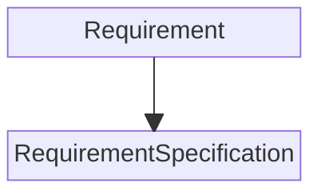

# Spector - Software Architecture

<https://share.google/aimode/85rXal2yiYofLAvB9>

- Model - where data is kept
- View ~ Presentation Layer - QT components (windows, widgets, etc.) + presentation logic (including receiving User input)
- Controller ~ Services - business logic

## Spector Layers



### Model

This is a layer where you keep your data.

We keep here only data that hold business value. It should be independent from particular application it is used in. We think here in categories of the Spector engine that can be used in many apps.

In Spector app we define here the basic data types:

- Requirement
- RequirementSpecification

```python
@dataclass
class Requirement:
    label: str
    description: str

@dataclass
class RequirementSpecification:
    title: str
    author: str
    version: str
    creation_date: datetime
    last_modification_date: datetime
```

## Undo

Undo is implemented as a list of actions that can be undone. Every action performed by the User is recorded as an action in this list.

### Action

- `type: str`
- `data: dict`

### Action Types

- `ADD_REQUIREMENT`
- `EDIT_REQUIREMENT`
- `REMOVE_REQUIREMENT`
- `REORDER_REQUIREMENT`

### Undo Algorithm

1. When an action is performed by the User, create an Action object with the appropriate type and data.
2. Append the Action object to the list of actions that can be undone.
3. If the list of actions that can be undone exceeds the maximum allowed size, remove the oldest action from the list.
4. To undo an action, remove the most recent action from the list and perform the inverse operation based on the action type and data.

Example:

1. User adds a new requirement.

```python
Action(type="ADD_REQUIREMENT", data={"requirement": Requirement(label="New Requirement", description="Description of the new requirement")})
```
